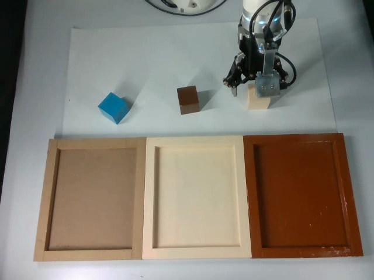
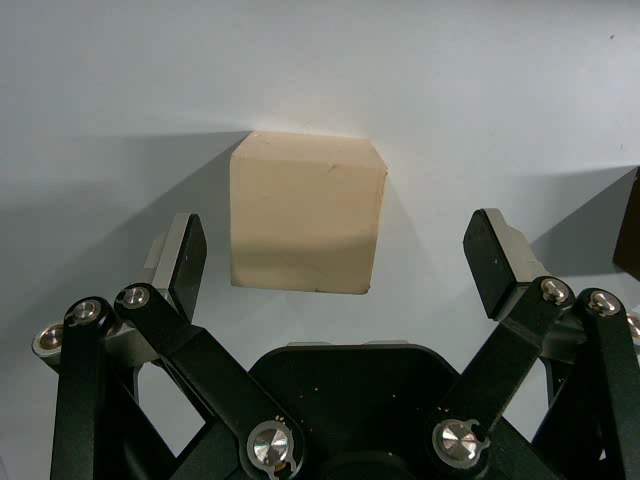
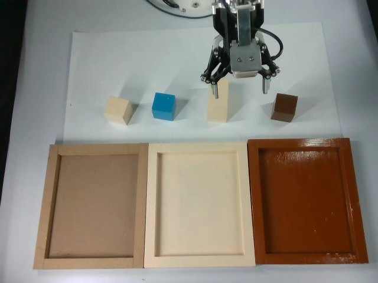
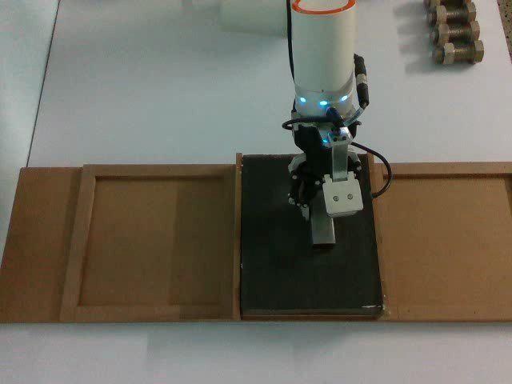
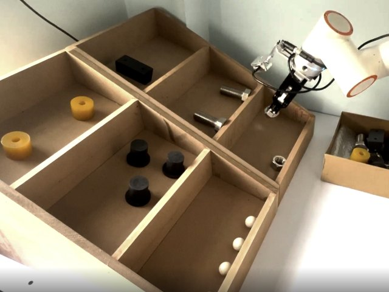

# Teaching a Fairino FR5 from Demonstrations, Part 1: Hardware, Teleoperation and Data

**Sreevaatsav B** · with Vivek Kanjarla · SliAct Robotics

---

## Abstract

This is the first of three posts about training robot policies for a Fairino FR5, a collaborative robot arm with six joints. Here I cover the data side: the hardware, the two teleoperation setups we used, how recordings get converted into a training dataset, and the three datasets we collected (1,021 demonstrations, about 11.5 hours). Several problems in the data only became visible after trained policies failed on the robot, so I describe those too.

---

## 1. Introduction

In imitation learning, a person demonstrates a task while the robot records its camera images and its own joint positions. A neural network (the *policy*) is then trained to predict the person's actions from those recordings, and is later run on the robot by itself.

Around March 2026 I started reading seriously about robot policy learning, and soon after, a batchmate (Vivek) and I got the chance to build prototypes for Indian factory tasks on a Fairino FR5. Our goal was fairly simple: get the FR5 to do a few manipulation tasks on its own at 30 Hz, using only data we collected ourselves. Most of the published work in this area, from ACT [1] to vision-language-action models like π0 [2], is trained on large, carefully curated datasets. We didn't have that, and a lot of our time went into figuring out what was wrong with the data we did have.

---

## 2. Hardware

| component | details |
|---|---|
| robot | Fairino FR5, 6-DOF collaborative arm |
| cameras | Intel RealSense D405 on the wrist, plus a fixed scene camera; 640×480, letterboxed to 224×224 for training |
| control rate | 30 Hz when running a policy; 125 Hz servo loop during teleoperation |
| action | 6 joint angles in degrees, plus gripper (0 = open, 1 = closed) |
| state | 6 measured joint angles, plus current gripper state |
| teleoperation | SO-101 leader arm at first, then a Meta Quest 3 controller |

<!-- TODO(Vaatsav): add a photo of the full setup (arm, both cameras, workspace). -->



*Figure 1: The FR5 workspace, seen from the scene camera (left) and the wrist camera (right) as the gripper reaches for a block.*

---

## 3. Teleoperation

Teleoperation means a person driving the robot live. All our demonstrations were collected this way.

### 3.1 SO-101 leader arm

We began with an SO-101, a small, cheap arm that you move by hand. The FR5 copies its joint angles. This is the usual setup in the LeRobot ecosystem and it let us start collecting within a few days.

The main problem was that the SO-101 has five joints and the FR5 has six. We had to freeze one of the FR5's joints and map each of the others to an SO-101 joint, which limited how the robot could move. Demonstrations where the gripper had to travel a long way from one position to another weren't feasible this way, so we switched to teleoperating with a Meta Quest controller. Building the teleoperation setups took about three to four weeks, alongside my other work.

### 3.2 Meta Quest over ROS 2

We then switched to a Meta Quest controller using the Quest2ROS app [3], connected through ROS 2 (Robot Operating System 2, the standard software layer robots use to pass messages between programs). The flow is:

```
Meta Quest (Quest2ROS app)
   │  ROS-TCP over Wi-Fi
   ▼
controller pose + buttons
   ▼
change in pose since the clutch was pressed (Cartesian space)
   ▼
FR5 inverse kinematics → joint commands at 125 Hz
```

Here, *Cartesian space* means describing the gripper by its x, y, z position and orientation rather than by joint angles, and *inverse kinematics* is the step that converts a desired gripper pose into joint angles. The operator holds a "clutch" button to move the arm and lets go to freeze it, so they can reposition their hand without the robot following, a bit like lifting a mouse off the table.

Getting rotation right took a couple of attempts. An earlier version, built on WebXR, only rotated the axis of the controller's rotation vector instead of transforming the whole rotation into the robot's frame, and the gripper tumbled around unpredictably. The correct version transforms the rotation change like this:

$$
\Delta R_{\text{base}} = M \,\Delta R_{\text{ctrl}}\, M^{\top}
$$

$M$ is the fixed rotation between the controller's frame and the robot's frame. We measure it with a small calibration tool instead of guessing: move the controller about 20 cm along one direction and see which way the robot would go. The code is at [quest2ros2-fr5](https://github.com/SreevaatsavB/quest2ros2-fr5).

---

## 4. Recording and conversion

Each episode is recorded as:

- a CSV log of joint positions and gripper state at about 100 Hz,
- videos from the wrist and scene cameras at about 30 Hz,
- a `meta.json` file with the task instruction.

Because the robot log and the cameras run at different rates, the converter resamples the robot log to the camera frame rate, so each frame gets one robot state. The output is a LeRobot v3.0 dataset [4], which most open-source robot policies can read directly. We also pre-extract JPEG frames, because seeking through video files on every training step was too slow.

---

## 5. Datasets

| task | episodes | raw hours | hours used for training | instructions | Hugging Face dataset |
|---|---|---|---|---|---|
| colour sorting | 400 | 5.06 | 5.06 | 9 | `Slifold/fr5-pick-place-lerobot-v2` |
| sanding | 265 | 5.41 | 4.44 | 1 | `VivekKanjarla/Sanding` |
| pick-to-light | 356 | 0.99 | 0.82 | 6 | `VivekKanjarla/datasets` |
| total | 1,021 | about 11.5 | | | |

In colour sorting, the robot picks up the blocks of one colour (blue, brown or cream) and places each in the tray named in the instruction (brown, cream or wooden), which gives nine instructions. In sanding, it holds a metal block against sandpaper and sands it. This is the most contact-heavy task, since success depends on how hard and how steadily the robot presses, not only on where it moves. In pick-to-light, it takes an object out of a specified rack slot and places it somewhere else.

The difference between raw and training hours comes from a filter we added later. The recorder's gripper command blocks the control loop for about 1.85 seconds, but the cameras keep recording, so around 50 frames at every grasp end up paired with the same frozen robot state. Part 2 (§5) explains why this was a real problem. We now drop frames whose robot reading is out of date, which removes about 18% of sanding and 17% of pick-to-light. Colour sorting was converted before this filter existed, so it still has those frames.

Pick-to-light is also much smaller than the other two, and the objects aren't balanced:

| object | episodes | hours | share |
|---|---|---|---|
| rubber ball | 99 | 0.313 | 31.7% |
| nut | 81 | 0.216 | 21.9% |
| rubber stopper | 70 | 0.180 | 18.2% |
| spacer | 55 | 0.146 | 14.8% |
| bolt | 49 | 0.128 | 13.0% |
| rubber cylinder | 2 | 0.006 | 0.6% |

There are 22 seconds of rubber cylinder data, and we're still asking the model to recognise it among six objects. The biggest class has about 19 minutes, compared with roughly 34 minutes per instruction in colour sorting. Our early pick-to-light runs behaved like you'd expect with this little data: validation loss was lowest after the first epoch, training and validation loss were far apart, and correcting the learning-rate warm-up changed the result by only 1.5%.




*Figure 2: The three tasks: colour sorting (left), sanding (middle) and pick-to-light (right). The first two are frames from the scene camera; the third is a still of the pick-to-light setup.*

---

## 6. Problems we found in the data later

We didn't notice any of these while collecting. Each one came up while trying to explain why a trained policy was misbehaving.

### 6.1 Very small motion per frame

Our operators moved slowly and carefully, and a colour-sorting episode lasted 46 seconds on average and a sanding episode about 74 seconds. On average the arm moves about 0.06° between camera frames, while a joint's position varies over about 13° in an episode, a ratio of roughly 224 to 1. After normalising the actions, the per-step motion, which is the part that actually moves the robot, takes up less than half a percent of the model's output range. Part 2 shows how this made our first π0 policy drift off course, and how we changed the action representation to deal with it.

### 6.2 Every episode had its own instruction

In colour sorting, operators typed the instruction for each episode in their own words, so the 400 episodes ended up with 400 different sentences, even though there were only 9 actual tasks. No two episodes shared a sentence, so each sentence worked like an ID tag for one recording. A model can learn "this exact sentence goes with this exact recording" instead of learning what the words mean. We replaced them with one plain sentence per task, such as "Pick up each blue block and put it in the brown tray.", so the 400 sentences became 9 and each one appears in about 44 episodes.

### 6.3 Long-horizon tasks with a single label

Our tasks are long-horizon. A colour-sorting episode lasts 46 seconds on average, and up to three minutes, and is made of many smaller steps (in colour sorting: reaching, grasping, carrying and releasing each object), but the whole episode has one instruction sentence. π0 was pretrained differently, with short labels describing roughly 2-second pieces of each episode, around 30 labels per episode [2]. So the part of the model that reads language learned to answer "what should I do in the next couple of seconds," and we were asking it about the whole episode. We ran into a few problems with these long tasks because of this. Fixing it means annotating the steps within each episode during data collection, and it's the first thing I'd change next time.

### 6.4 Teleoperation is slow and tiring

Collecting data this way took far longer than we expected. An episode has to be done in one go, and if the operator makes one mistake near the end, the whole episode has to be recorded again. This is one of the reasons we later started looking at UMI grippers [5], handheld grippers with a camera that let you collect manipulation demonstrations without driving the robot at all.

### 6.5 Gripper conventions

Our gripper uses 0 for open and 1 for closed. π0's pretraining data mixes conventions (ALOHA uses the opposite, DROID matches ours), so the gripper gets no real benefit from pretraining and is learned mostly from our data.

---

## 7. Limitations

- All tasks were recorded in one environment on one robot, so none of this says anything about new scenes.
- Pick-to-light is small (0.82 hours used for training) and unbalanced across objects.
- Colour sorting still contains the gripper-stall frames that the other two datasets filter out.

---

## 8. Next

[Part 2](./fr5-part-2-policies-and-results) covers the policies we trained on this data, the bugs that turned out to be behind most of our failures, and the final π0 results. [Part 3](./fr5-part-3-flow-matching) works through the maths of flow matching, which is how π0 generates actions.

---

## A note on AI tools

I used AI tools, including Claude Code, while building this project and writing this post.

---

## References

[1] T. Z. Zhao, V. Kumar, S. Levine, C. Finn. *Learning Fine-Grained Bimanual Manipulation with Low-Cost Hardware* (ACT). RSS 2023. arXiv:2304.13705

[2] K. Black et al. *π0: A Vision-Language-Action Flow Model for General Robot Control*. arXiv:2410.24164, 2024.

[3] Quest2ROS. https://quest2ros.github.io/

[4] Hugging Face LeRobot. https://github.com/huggingface/lerobot

[5] C. Chi et al. *Universal Manipulation Interface: In-The-Wild Robot Teaching Without In-The-Wild Robots*. RSS 2024. arXiv:2402.10329

**Code:** [fairino-fr5-policies](https://github.com/SreevaatsavB/fairino-fr5-policies) · [quest2ros2-fr5](https://github.com/SreevaatsavB/quest2ros2-fr5)
