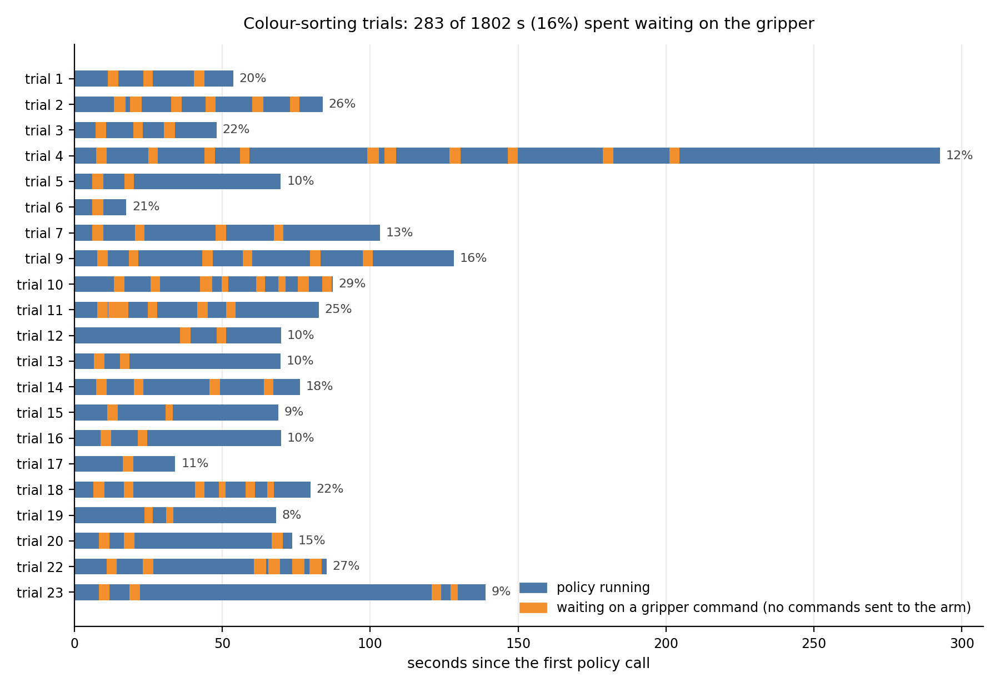

# Teaching a Fairino FR5 from Demonstrations, Part 2: Why Pretrained Policies Failed on Our Robot, and What Fine-Tuning Fixed

**Sreevaatsav B** · with Vivek Kanjarla · SliAct Robotics

---

## Abstract

From May to September 2026 we trained seven kinds of policy on a Fairino FR5 using the data described in [Part 1](./fr5-part-1-setup-and-data): ACT, Diffusion Policy, a Diffusion Transformer trained with flow matching, Octo, π0, π0-FAST and π0.5. The pretrained π0, π0.5 and Octo models didn't work on our robot out of the box, which is why every policy here is trained on demonstrations we collected ourselves. When policies failed on the robot, my first guess was usually the model. In most cases the actual cause was elsewhere: inputs formatted differently from π0's pretraining data, actions at a scale the model couldn't resolve, and recordings that showed the robot freezing at every grasp. This post goes through how we found each of these. Our final π0 policies succeeded in 16 of 20 sanding trials (80%) and 13 of 20 colour-sorting trials (65%). The sanding policy was fine-tuned starting from the colour-sorting one.

---

## 1. Introduction

At the start, we tried the pretrained π0 and π0.5 models as they were, without training them on anything of ours, on colour sorting and simple pick-and-place. They failed badly. The arm struggled to even move the gripper towards the object it was supposed to pick up, and the gripper struggled to grasp it. Octo, which we also tried without fine-tuning, did no better: its success rate was close to 0%. These failures are the reason for everything in this post: to get these models working on our robot, we had to fine-tune them on our own demonstrations.

So we started by training ACT, Diffusion Policy, π0 and π0.5 on simple pick-and-place tasks, mostly to get the new cobot working in an environment none of these models had seen. The original plan was to turn that into a proper comparison: train several policy types on the same data and the same robot, and see which works best. All of them share one training and deployment codebase ([fairino-fr5-policies](https://github.com/SreevaatsavB/fairino-fr5-policies)), so switching between them doesn't touch the shared code. I worked on the training and inference pipelines, evaluation and data preparation.

*Video 1: ACT on one of the early pick-and-place tests, picking up the block and dropping it into the bowl (real time)*

The comparison never really happened in a clean way, because we kept running into problems that had nothing to do with which architecture we picked. Those problems ended up being the most useful part of the project, so this post is organised around them.

| policy | short description | what happened |
|---|---|---|
| ACT [1] | conditional VAE plus transformer, predicts 100 future actions at once | first baseline, failed on the robot (§2) |
| Diffusion Policy [2] | denoising diffusion with a 1-D U-Net | baseline |
| DiT + flow matching | Diffusion Transformer with frozen DINOv3 image features and CLIP text features | jerky until we added temporal ensembling |
| Octo [3] | generalist policy pretrained on 800k Open-X trajectories | tried zero-shot and fine-tuned |
| π0 [4] | vision-language-action model: 2B-parameter PaliGemma plus a 300M-parameter action expert | final policy |
| π0-FAST | π0 with actions encoded as discrete tokens | comparison run |
| π0.5 [5] | π0 with longer language context | pick-to-light, still training |

---

## 2. ACT and posterior collapse

The first serious attempt was ACT with a frozen DINOv2 image encoder, trained to pick up a marker and drop it into a bowl. On the robot it moved toward where the marker usually was, not where it actually was. It stopped near the grasp point, closed the gripper on nothing, and never moved on to the bowl.

Looking into it, we found three well-known imitation-learning problems happening together. When demonstrations differ, a model trained with a regression loss can learn their average, which may not be a sensible trajectory at all. Because our demonstrations were slow, the current joint angles were a very good predictor of the next action, so the model leaned on them and mostly ignored the camera. And once the robot drifted slightly away from the demonstrated path, it was in situations it had never seen, and the errors grew.

The training logs showed something that made all of this worse. ACT uses a conditional variational autoencoder (CVAE) whose latent variable is supposed to capture variation between demonstrations. A KL penalty keeps that latent close to a standard Gaussian, and ours had a weight of 10. That was strong enough to drive the KL term to zero, which means the latent stopped carrying any information. This is called posterior collapse, and it turns ACT into plain regression, which is exactly the setting where averaging happens.

We reduced the KL weight to 0.5, ramped it in over 2,000 steps, and added a "free bits" floor of 0.03 per latent dimension so the optimiser couldn't push it all the way to zero. We also added a probe that compares how much the model depends on vision versus joint state, and randomly dropped the joint state during training so it had to use the images. The large gap between training and validation loss suggested overfitting rather than a model that was too small, so making it bigger wasn't the answer.

The way we worked through this, listing every symptom and looking for one cause that explained all of them, is roughly how we approached every problem after it.

> **[Video 2: ACT rollout, closing the gripper in mid-air]**

---

## 3. Inputs that didn't match π0's pretraining format

Fine-tuning tends to work better when your inputs look like the inputs the model was pretrained on. Comparing our pipeline against the openpi code, we found three differences and fixed them together:

1. **Prompt ending.** PaliGemma, which π0 uses for language, saw a newline at the end of every pretraining instruction. It acts as a marker that the instruction is over. We weren't adding it.
2. **Image shape.** We were squashing 640×480 frames to 224×224. Pretraining used letterboxing, which keeps the aspect ratio by resizing to 224×168 and adding 28-pixel bars at the top and bottom. Squashing changes the shape of every object in the image.
3. **One instruction per episode.** This is the issue from Part 1 (§6.2), where each sentence identified a single episode. We cut the vocabulary down to one shared sentence per task.

These settings are saved inside each checkpoint, so deployment uses the same format the model was trained with.

We also changed our training schedule. We had planned 100 epochs at a fixed learning rate, which works out to about 330,000 optimiser steps. openpi's own fine-tuning configs use 30,000 steps at batch size 32, with 1,000 warm-up steps and cosine decay of the learning rate from 2.5e-5 to 2.5e-6. We had been planning about eleven times their budget.

---

## 4. Predicting actions at the wrong scale

With all of the above fixed, a π0 checkpoint trained for 30,000 steps behaved well for about 3 seconds, then drifted for 12 more and never closed the gripper. Its validation L1 error was 0.0339, which looked very good.

### 4.1 What we measured

From Part 1: the arm moves about 0.06° per frame, but the model was predicting absolute joint angles that vary over about 13° per episode. We compared the model with two trivial predictors on held-out episodes:

| predictor | average error per step |
|---|---|
| repeat the current joint angles (don't move) | 0.075° |
| trained π0 | 1.656° |
| always predict the dataset's average action | 9.775° |

So the model is about 6 times better than guessing the average, which means it had learned the rough shape of the motion. But it's about 22 times worse than not moving at all, and its error is many times larger than the motion it is supposed to produce. The robot logs were consistent with this:

| on the robot | explanation |
|---|---|
| median commanded step of 2.44°, 13 times the demonstrations' 0.187° | mostly model error, not intended motion |
| our 1° per step safety limit was hit on 65% of commands | expected at that speed |
| gripper output never went above 0.154 in 450 steps (closing needs 0.65) | the gripper prediction was just as noisy |
| fine for about 100 steps, then drifting | errors building up from the start |

### 4.2 The fix

We changed the model to predict how much each joint should move relative to its current position, rather than where it should end up:

$$
a_k = a_{t+k}^{\text{abs}} - s_t \quad \text{(6 joints)}, \qquad a_k^{\text{grip}} = a_{t+k}^{\text{grip}} \quad \text{(gripper unchanged)}
$$

The gripper stays absolute because it's an open/close command, not a position. When I checked, openpi applies this same transformation in all of its fine-tuning setups that use joint positions (ALOHA, LIBERO and DROID with joint actions), so we had been the odd one out.

We also tried predicting every 5th frame (a "stride" of 5), so each predicted step covers more motion and is easier to see. This turned out to help only if the chunk also gets shorter. The reason is a bit subtle: the actions are scaled using statistics from every position in the chunk, and the far end of a long chunk has much bigger values, so it stretches the scale and the first action (the one the robot actually executes) becomes small again. In the table below, the third column is roughly "how big the first step looks to the model", so higher is better:

| setting | time covered | size of the first step after scaling | compared with absolute |
|---|---|---|---|
| absolute targets | 1.67 s | 0.0009 | 1× |
| relative, chunk 50, stride 1 | 1.67 s | 0.0420 | 45× |
| relative, chunk 10, stride 5 | 1.67 s | 0.0408 | about 45× |
| relative, chunk 50, stride 5 | 8.33 s | 0.0115 | 13× |

Most of the gain comes from predicting relative motion. We settled on a chunk of 10 with stride 5. With a stride, each predicted action has to be held for 5 control steps when deployed, otherwise the arm plays the motion back five times too fast. The checkpoint stores this setting so it can't be deployed incorrectly.

### 4.3 How we evaluate now

After seeing a validation loss of 0.0339 on a policy that did worse than standing still, we stopped using validation loss alone to decide whether a checkpoint was worth testing on the robot. We wrote down a pass/fail check before running it on new checkpoints: the model has to beat the "don't move" predictor on every held-out episode, and its gripper prediction has to cross the closing threshold where the demonstration closes. The 30,000-step checkpoint fails both, and there's a test that confirms it still fails, so the check can't quietly become more lenient.

The same investigation turned up a few smaller issues. We had been using LoRA (low-rank adaptation, which trains small add-on matrices instead of the full weights), but the layer names we gave it only matched the language part of the model, so the image encoder was barely adapting to our cameras. The deploy loop claimed to send commands at 30 Hz but was actually managing about 16.7 Hz. And the log of "executed" actions was really storing the raw predictions. In the end we switched to fine-tuning the whole model, which is openpi's main recipe and made the LoRA problem go away.

---

## 5. Recordings that taught the robot to stop

Converting the sanding data exposed another problem, the gripper stall from Part 1. The gripper command blocks the control loop for about 1.85 seconds while the cameras keep running, so roughly 50 frames at every grasp are paired with one frozen robot state, which was 18 to 19% of the frames in the episodes we checked. A policy trained on this learns that the right thing to do just before a grasp is to stop. Once it stops, the camera image doesn't change, so it has no reason to start again. We now drop frames whose robot reading is out of date.

Deployment had a similar stall. In our recorded colour-sorting trials, every gripper open or close held up the control loop for 3 to 4 seconds, during which no commands were sent to the arm. Across 21 trials that came to 283 of 1,802 seconds, or 16% of the run time.

*Figure 3: Each recorded colour-sorting trial, split into time with the policy running (blue) and time waiting on a gripper command (orange). Trial 8 is left out because its log files are copies of trial 9's.*

A lot of what we fixed was found by looking at the frames the model was actually being trained on, rather than at loss curves.

---

## 6. Final setup

| setting | value |
|---|---|
| base model | `lerobot/pi0_base` |
| fine-tuning | whole model (language model, image encoder and action expert) |
| actions | joint changes relative to current state, absolute gripper, stride 5 |
| chunk | 10 actions (1.67 s), re-planned during execution |
| cameras | wrist and scene, letterboxed to 224×224 |
| schedule | up to 30,000 steps, batch 32, 1,000 warm-up steps, cosine decay from 2.5e-5 to 2.5e-6, early stopping |
| hardware | one A100 80 GB, bfloat16, gradient checkpointing |
| inference | 10 flow-matching integration steps |

For sanding, we didn't start from the base π0 model, which had never seen our robot or cameras. We started from the colour-sorting checkpoint, which had already spent six epochs on the same setup (the epoch with the lowest validation loss, L1 = 0.3616).

That colour-sorting run had no early stopping. Validation loss was lowest at epoch 6 and then rose until the run ended at epoch 23, so about three-quarters of its GPU time was wasted. Only saving the best checkpoint kept it usable. For sanding we stopped training once validation loss hadn't improved for 3 epochs.

---

## 7. Results

| task | policy | trials | successes |
|---|---|---|---|
| sanding | π0, started from the colour-sorting checkpoint | 20 | 16 (80%) |
| colour sorting, 9 instructions | π0 | 20 | 13 (65%) |
| pick-to-light | π0.5 | still training | n/a |

<!-- TODO(Vaatsav): state what counted as a success for each task and add a short breakdown of how the failures happened (missed grasp, wrong bin, lost contact, etc.). Confirm which checkpoints these came from. -->

*Video 3: π0 sanding, successful trial (scene and wrist cameras on the left, 4× speed). On the right, each joint over the last 6 seconds: the dashed line is the position the policy asked for at each step, and the solid line is the position actually sent to the arm after the controller's speed limit. The gaps are where the control loop paused for a gripper command.*

*Video 4: π0 colour sorting (scene camera, 4× speed). Left: picking up a cream, a blue and a brown block in turn and placing each in the dark tray. Right: placing a red packet, then failing to grasp a computer mouse several times.*

*Video 5: The first minute of six colour-sorting trials with different objects and target trays (4× speed).*

I expected sanding to be the harder task because of the contact involved, but it scored higher. My guess is that sanding is a single repeated motion with one instruction, while colour sorting needs the model to match nine instructions to the right objects and bins using only single images. For colour sorting, choosing the right action seems to be harder than executing it.

This connects to the biggest limitation of our setup. π0 sees only the current frame, and our instructions describe a whole episode, 46 seconds on average for colour sorting, while π0 was pretrained on instructions for roughly 2-second segments. In a long task with several stages, one frame and one sentence often don't make it clear which stage the robot is in.

We ran into this directly when we tried chaining tasks. We put a GPT model on top of our fine-tuned policies as a planner and critic, to decide which sub-task to run next and to check whether each one had worked. Across runs of pick-and-place followed by sanding, the sequencing worked every time, but the sanding itself often failed: the block wasn't pressed properly onto the sandpaper, and neither the planner nor the policy noticed, because nothing in the system could sense contact force. Vision alone wasn't enough for that. Getting a single task to work and getting a whole sequence of tasks to finish turned out to be two very different problems, and that gap is what I'd most like to work on next.

More generally, these policies can reproduce the motions in the demonstrations, but they have no sense of force or touch. In some sanding trials the policy held the block just above the sandpaper, going through the right motion without actually touching it. Right now the wrist camera is the only thing that tells the policy whether there is contact. The D405 on the wrist also records depth, which would give the policy another view of how close the block is to the sandpaper, but we skipped it for now.

<!-- TODO(Vaatsav): confirm the exact GPT model name you used as planner/critic and roughly how many chained runs you did. -->

---

## 8. Limitations

- With 20 trials per task the uncertainty is large: 16 out of 20 is consistent with a true success rate anywhere from about 58% to 92%.
- Everything was done in one environment with one robot, on our own tasks.
- Many fixes went in close together, and we didn't run ablations, so I can't say how much each one contributed.
- The other policies (ACT, Diffusion Policy, DiT, Octo) weren't retrained with the final data pipeline, so this isn't a fair comparison between architectures.

---

## 9. Next steps

- Finish training π0.5 on pick-to-light.
- Post-train XR-1 [6] on the same data (the conversion and training setup are done), and try a video action model.
- Improve the planner and critic setup from §7 for multi-step tasks, and find a way to detect contact failures like the sanding one.
- Collect data with UMI grippers instead of teleoperation, since teleoperated episodes are slow to record and a single mistake means redoing the whole episode.

[Part 3](./fr5-part-3-flow-matching) covers the maths of flow matching, which is how π0's action expert generates actions.

---

## A note on AI tools

I used AI tools, including Claude Code, while building this project and writing this post.

---

## References

[1] T. Z. Zhao, V. Kumar, S. Levine, C. Finn. *Learning Fine-Grained Bimanual Manipulation with Low-Cost Hardware* (ACT). RSS 2023. arXiv:2304.13705

[2] C. Chi et al. *Diffusion Policy: Visuomotor Policy Learning via Action Diffusion*. RSS 2023. arXiv:2303.04137

[3] Octo Model Team. *Octo: An Open-Source Generalist Robot Policy*. RSS 2024. arXiv:2405.12213

[4] K. Black et al. *π0: A Vision-Language-Action Flow Model for General Robot Control*. arXiv:2410.24164, 2024.

[5] Physical Intelligence. *π0.5: a Vision-Language-Action Model with Open-World Generalization*. arXiv:2504.16054, 2025.

[6] Xiaomi Robotics. *XR-1*. <!-- TODO(Vaatsav): add the exact XR-1 citation. -->

**Code:** [fairino-fr5-policies](https://github.com/SreevaatsavB/fairino-fr5-policies)
